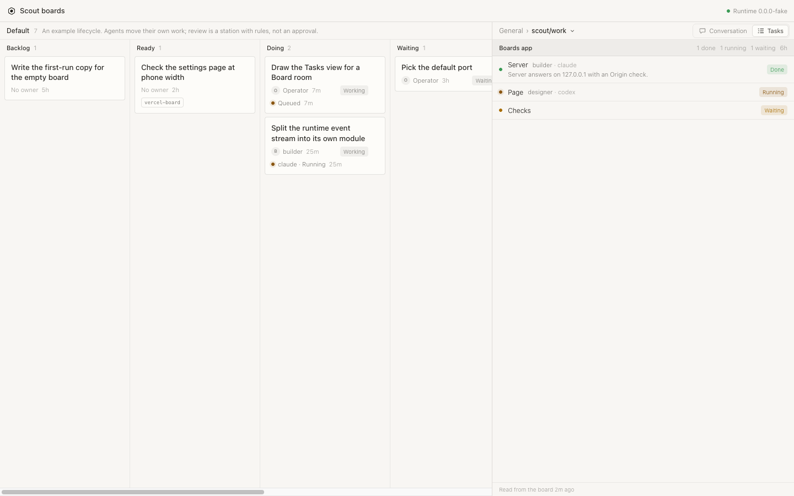
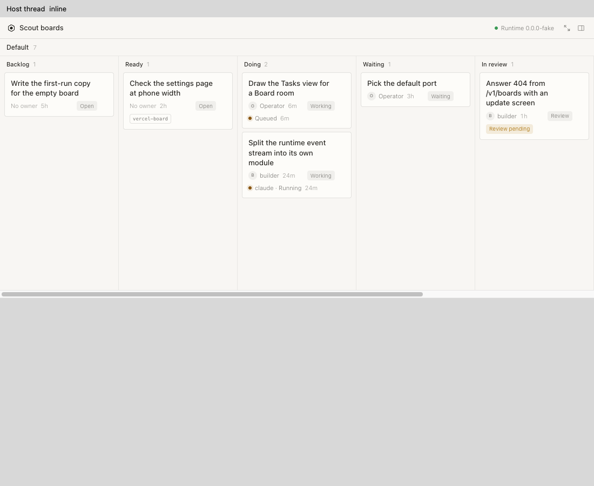
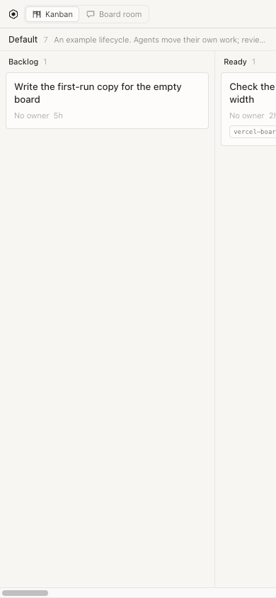
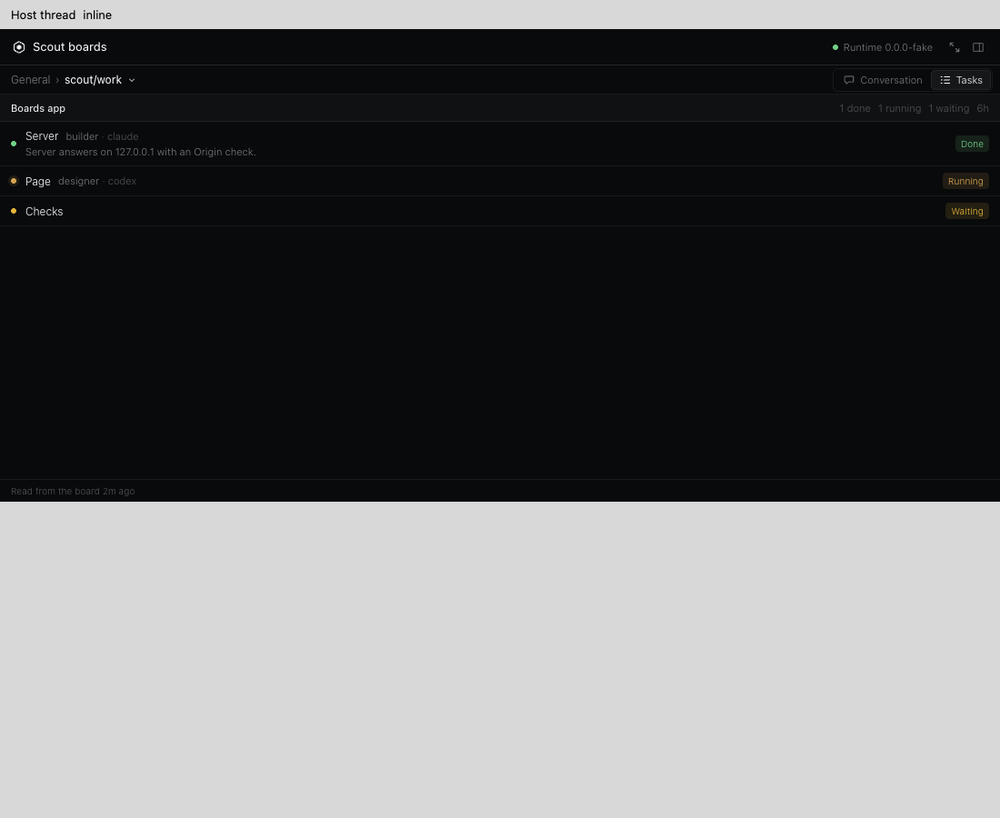

# Scout boards

Scout's work in two areas, as in Scout's own app. **Conversations** lists the
Vercel Board rooms Scout follows, each with its thread and its tasks. **Board**
is the Kanban: the board's stations are the columns and the work items are the
cards. Open a card, move it, review a move or claim work, or open the room it
came from. Every move goes to Scout's runtime, which checks it against the
board's rules and records it.



```sh
npx -y github:openscout-app/boards
```

The launcher defaults to http://localhost:4802. Add `--no-open` to skip the browser.
It reuses a listener for the same app and configured runtime (`SCOUT_RUNTIME_URL`),
or prints the available URL it chose. With `--port <n>` (or `PORT`), it
uses only that port and reports a collision rather than moving to another one.

`GET /api/hello` identifies the app and its configured runtime instance without
calling Scout. `GET /api/status` probes the current runtime: `listening` describes
the local server, `readable` and `writable` describe the board list and
dry-run move endpoint, and `nodeId` is null when the runtime does not identify itself.
The write probe does not change records or guarantee a particular action will
pass the runtime's rules.

Boards needs Node 20 or later.

## First run

| What you see | What to do |
| --- | --- |
| No runtime | `npx github:openscout-app/boards setup` starts Scout's runtime |
| This Scout is too old for boards | `scout update`. Board rooms still show |
| No Board connected | `scout integration connect vercel-board --team <team> --credential env:VERCEL_TOKEN` |
| Nothing on this board yet | Work items the runtime places on the board show up as they arrive |

Boards shows the newest 12 cards in each column alongside the full column count.
Use **Older cards** to read the next page in that column. The `work_board` MCP
tool accepts a column ID and the `nextCursor` returned for it. Older runtimes
serve one shared window of up to 500 cards. A plus sign marks counts that may
be incomplete.

## Commands

```sh
npx github:openscout-app/boards                 # start it and open the page
npx github:openscout-app/boards --no-open       # start it without opening a browser
npx github:openscout-app/boards --port 4900     # another port
npx github:openscout-app/boards setup           # start the runtime, add the MCP tools and `scout boards`
npx github:openscout-app/boards setup --print   # show those commands instead of running them
npx github:openscout-app/boards mcp             # the MCP server, over stdio
```

If Scout boards already runs on the port, the command opens it instead of
starting a second one. Once `setup` has run, `scout boards` does the same from
Scout's CLI.

## In an agent's thread

Scout boards is also an MCP server with an MCP App view, so the Kanban and the
Board rooms show inside the thread of a host that draws MCP Apps.

| Host | How |
| --- | --- |
| Claude Code | `npx github:openscout-app/boards setup`, or install the plugin in `plugin/` |
| Codex | Add the plugin in `plugin/` |
| T3 Code | Runs Claude Code: set it up there |

| Tool | Called by | Does |
| --- | --- | --- |
| `work_board` | The model | Shows the Kanban, and returns its columns and cards as text |
| `board_room` | The model | Shows a Board room Scout follows: its posts and its tasks |
| `api_read` | The view | Reads the board, a room or a card's moves, and checks a move without making it |
| `api_write` | The view | Moves a card, reviews a move or claims work. Hosts ask the person first |

The view's tools accept a fixed list of paths and nothing else. In the thread
the view shows one pane; Expand shows both, and a link opens the full page.



## What it reads

Scout boards talks to the runtime's HTTP API and nothing else. It keeps no
database and writes no record itself.

| Route | For |
| --- | --- |
| `GET /health` | Whether the runtime is up, and its version |
| `GET /v1/boards`, `GET /v1/boards/:id` | The boards and their cards. A 404 means the runtime is too old |
| `POST /v1/work/move`, `/v1/work/review`, `/v1/work/claim` | Moves (with `dryRun` for the preview), reviews and claims, as the operator |
| `GET /v1/work/moves` | A card's moves, for review |
| `GET /v1/events/stream` | Changes, so the page updates as work moves |
| `GET /v1/integrations/vercel-board/*`, `GET /v1/endpoints` | Board rooms, their posts and hand-offs |

It finds the runtime at `SCOUT_RUNTIME_URL`, then `OPENSCOUT_BROKER_URL`, then
the port in `~/.openscout/config.json`, then `http://127.0.0.1:43110`.

The page listens on 127.0.0.1 only and refuses requests from other origins.
Scout is for a developer's own host; Scout boards is not built for a shared
server.

## Development

```sh
npm install
node test/fake-runtime.mjs 43199                         # a runtime that serves the boards contract
SCOUT_RUNTIME_URL=http://127.0.0.1:43199 npm run dev     # the page, against it
npm test                                                 # node --test
npm run build                                            # the page in dist/, the view in dist/view/
```

`node test/fake-runtime.mjs 43199 --no-boards` stands in for a runtime too old
for boards, and `--no-rooms` for one without the Board adapter. Under
`npm run dev`, `/test/view-harness.html?kind=work-board` (or `board-room`, with
`&theme=dark` or `&mode=fullscreen`) frames the MCP view the way a host does.

| Light, narrow | The view, dark |
| --- | --- |
|  |  |

## License

Apache-2.0. See [LICENSE](LICENSE).

### Watch a card from MCP

On the existing `scout-boards mcp` stdio connection, MCP 2026-07-28 clients can discover
`io.modelcontextprotocol/events`. Call `events/list`, then `events/poll` with
`{"name":"board.card.moved","arguments":{"workId":"work-101"},"cursor":null}`.
The first response gives the current position. Pass its cursor on the next poll.
Moves and review reopens come from the runtime ledger, including changes made by
other operators. An older reopen record omits the destination. If `truncated`
is true, reread the card for its current placement. Existing MCP Apps hosts can
continue to use the board tools and view.
